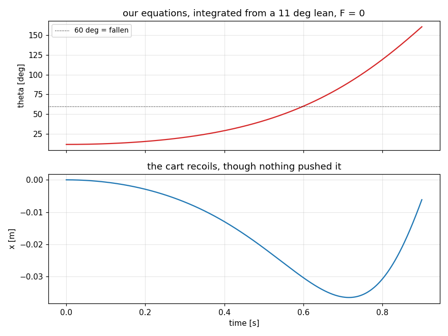
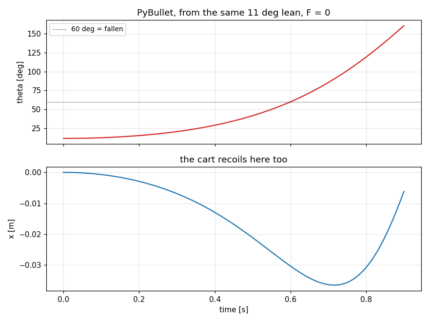

# Chapter 2 — Mathematical Modeling

A cart-pole in PyBullet, in five scripts.

By the end you will have (1) seen the pole fall, (2) typed in the
equations you derived on the board and integrated them, (3) watched the
physics engine trace the same motion and then proved it is solving *the
same equations*, and (4) balanced
it yourself with the arrow keys — and then seen, in your own keypress
data, that what your fingers were doing has a name: **feedback on the
error**.

That last step is the entry point to Chapter 3.

```
test.py                    load the cart-pole, let the pole fall over
model_equations.py         our equations, solved at one instant, then integrated
model_simul.py             the same motion, from PyBullet instead
model_test.py              our equations vs PyBullet, to 14 decimal places
cart_pole_sim_control.py   you balance it with the arrow keys
assets/cartpole.urdf       the robot description
```

Run them **from this folder** — the scripts load the URDF by relative
path:

```bash
cd simulation/cartpole
python test.py
python model_equations.py
python model_simul.py
python model_test.py
python cart_pole_sim_control.py
```

Install instructions are in [`../README.md`](../README.md). Each script
reads top to bottom, imports nothing from the others, and stops at
`Ctrl-C`.

## Coordinates

Put this on the board first.

```
x       cart position [m], +x to the right
theta   pole angle from straight up [rad], +theta leans right
F       force on the cart [N], +F pushes right

state   s = [x, theta, xdot, thetadot]
        s = 0 is upright — and that equilibrium is UNSTABLE
```

## 1. `test.py`

Loads the URDF, releases the joints, and lets go. The pole tips over on
its own, because upright is an equilibrium you cannot sit at.

Note what the cart does while the pole falls: it recoils. Nothing pushed
it. That coupling — the pole's fall drives the cart, the cart's motion
drives the pole — is the whole reason this is a two-degree-of-freedom
problem with only one actuator. **Underactuated** is the word.

## 2. `model_equations.py`

The equations from the board, typed in — then used two ways.

**Part 1 — one instant.**

```
[ M+m           m·lc·cos θ ] [ ẍ ]   [ F + m·lc·sin θ·θ̇² ]
[ m·lc·cos θ    I + m·lc²  ] [ θ̈ ] = [ m·g·lc·sin θ       ]
```

Two equations, two unknowns. Pin the state (lean 0.2 rad, at rest, no
push) and let `np.linalg.solve` do the algebra. That is linear algebra,
not a differential-equation solver: no time passes, and the answer is the
acceleration *right now*. `θ̈` comes out positive — leaning right, it
accelerates further right. It falls. That is the unstable equilibrium in
one number.

**Part 2 — integrate through time.** Acceleration is the rate of change
of velocity; velocity is the rate of change of position. So over a small
step `dt`:

```
velocity += acceleration * dt
position += velocity * dt
```

Repeat, and the state walks forward in time. That is numerical
integration (Euler's method, the simplest kind). The script runs it for
0.9 s from the same 0.2 rad lean and plots `θ(t)` and `x(t)`:

<p align="center">
  
</p>

The pole passes 60° at about 0.6 s. Watch the cart too: nothing pushed
it, yet it moves — the falling pole drags it through the off-diagonal
terms of the mass matrix.

Try `dt = 1/100`, then `1/10`. Euler drifts as the step grows: the answer
starts to depend on `dt`, which a correct physics never does.

A curve is not a check, though. These equations would draw something just
as plausible with a sign wrong somewhere. The next two scripts are the
check.

## 3. `model_simul.py`

The twin of Part 2 above, with one swap: instead of our loop solving the
matrix and adding `acceleration * dt`, `p.stepSimulation()` does that
inside PyBullet, and we only read the state back. Same 0.2 rad lean, same
`F = 0`, same 0.9 s.

<p align="center">
  
</p>

Put the two plots side by side. Same shape, same 0.60 s crossing of 60°,
same cart recoil. PyBullet has never seen our matrix — you handed it
bodies and joints and it worked out the motion itself — so the agreement
is not because one copied the other.

They are not identical to every decimal, though. PyBullet integrates one
way and `model_equations.py` another (Euler), and that integration error
shrinks as you refine `dt` in both. Now comment out the `changeDynamics`
loop that zeroes PyBullet's default damping: the curves diverge, and no
amount of shrinking `dt` brings them back. That is a *different model*,
not a numerical error. Telling those two apart cleanly is the next script.

## 4. `model_test.py`

The one that matters. Two answerers, same question:

| | what it is |
|---|---|
| **(A)** | PyBullet, the "real robot", which has never seen our algebra |
| **(B)** | the Lagrange equations we derived, typed in by hand |

Both are asked for the **acceleration** at the same random state and the
same force. They agree to about **10⁻¹⁴** — double-precision round-off:

```
acceleration,  ours vs PyBullet
   theta       F |    thddot sim      model     error
  -0.184    5.01 |    -10.06958  -10.06958   1.3e-14
   0.085    6.96 |     -8.79392   -8.79392   5.3e-15
  -0.398    3.67 |    -10.94394  -10.94394   1.2e-14
```

Our equations are not an approximation of the simulator's dynamics; they
are the same equations. Flip one sign in the mass matrix and the error
jumps from `1e-14` to about 20 — that is what the file is for.

Why acceleration at one instant, and not a trajectory? Over a trajectory
the numerical integration adds errors of its own, and a mismatch would
not tell you whether the equations or the integrator was at fault. One
instant leaves the equations nowhere to hide.

## 5. `cart_pole_sim_control.py`

| key | |
|---|---|
| **←** | push the cart left (`F < 0`) |
| **→** | push the cart right (`F > 0`) |
| **r** | start over |
| **q** | stop and see the plots |

> Click on the PyBullet window first, or it will not see your keys.

**Before you touch the keyboard**, replace `F` in the loop with a
constant, then a sine wave, and run it. Every input you can choose in
advance drops the pole, no matter how clever. Holding an unstable
equilibrium means reacting to the error you actually have, and a function
of `t` alone has no way of knowing it.

**On difficulty.** The unstable pole sits at +3.97 rad/s — a 0.25 s time
constant — and human reaction time is about 0.2 s. In real time this is
close to impossible, which is why the script runs at **1/3 speed**. Edit
`SPEED = 1.0` once you can hold it at a third, and feel how much of the
task was the delay rather than the physics.

`FORCE` is worth an experiment too. Raising it makes the task **harder**,
not easier: with a reaction delay, a bigger push overshoots. Larger gain
is not better gain — a fact Chapter 3 will make precise.

### The reveal

Press `q` and two plots come up. The second is the one that matters: the
force **you** applied against the angle you were looking at.

An arrow key is all-or-nothing, so the plot is two bands rather than a
line. But notice which band sits on which side. Positive angle, positive
force — you pushed *toward* the lean, essentially every time, without
being told to. The script prints the percentage.

That is feedback:

```
error   e = theta - theta_desired = theta      (upright => theta_desired = 0)
```

Chapter 3 keeps the idea and drops the all-or-nothing part, pushing in
proportion to the error instead so it can act gently near upright:

```
F = -K * e
```

### One more thing to notice

Watch *how* you lose. Often the pole never drops at all — the **cart runs
off** while the pole stays vertical. You were watching `theta` and nothing
was watching `x`. Holding the pole up and keeping the cart in place are
two objectives, and there is only one actuator.

That is where Chapter 3 begins.

## The two gotchas

Both appear in every script that loads the robot, and both are silent when you get them
wrong.

**1. PyBullet's default damping.** Every body gets `angularDamping = 0.04`
unless you say otherwise. Our equations have no friction term at all, so
without this the simulator is solving a different problem and
`model_test.py` will never agree:

```python
p.changeDynamics(robot, link, linearDamping=0, angularDamping=0, jointDamping=0)
```

**2. The default joint motors.** Straight after `loadURDF`, every joint
has a velocity motor holding it at zero speed with a large maximum force.
It silently cancels any force you apply, and it stops the pole from
tipping at all:

```python
p.setJointMotorControl2(robot, joint, p.VELOCITY_CONTROL, force=0)
```

`resetJointState` re-enables those motors, so release them again after
every reset.

## Why a custom URDF?

`pybullet_data` ships a `cartpole.urdf`, but every link in it carries a
placeholder inertia tensor of `ixx = iyy = izz = 1.0`. For our pole
(m = 0.1 kg, L = 1 m) the true inertia about the hinge axis is

```
I_yy = m(L² + w²)/12 = 0.00835 kg·m²
```

roughly **120× smaller**. With the stock file, the equations you derive on
the board do not match the simulator, and `model_test.py` would "prove"
your correct derivation wrong. `assets/cartpole.urdf` fixes the inertias.

## Troubleshooting

**My control input does nothing.** Gotcha 2 above.

**My model disagrees with the simulator.** Gotcha 1 above, or the URDF
inertias.

**Torque only applies for one step.** `TORQUE_CONTROL` is cleared by every
`stepSimulation()`. Re-apply it on every step.

**Arrow keys do nothing.** Click the PyBullet window to give it focus.
`p.getKeyboardEvents()` only reports keys when its own window is focused.

## What's next

Chapter 3 replaces your fingers with a controller you design on purpose:

- **PID** — pick `k_p`, `k_i`, `k_d` deliberately rather than by instinct
- **Full state feedback** — use all of `[x, theta, xdot, thetadot]`, and
  finally control the cart position too
- **LQR** — state what you care about with `Q` and `R` and let the Riccati
  equation return the gain

All three need a **linear** model, `sdot = As + Bu`, which means
linearizing the equations `model_test.py` just verified: `sin θ → θ`,
`cos θ → 1`, drop the `θ̇²` term.
